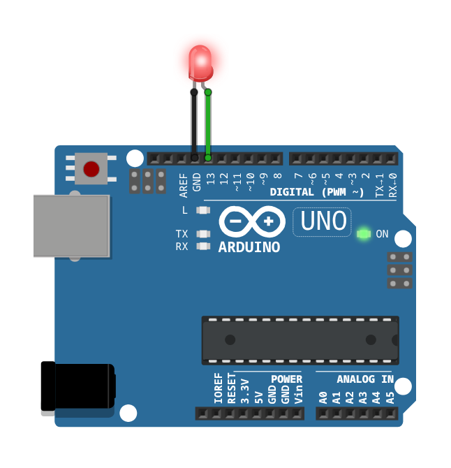

# Blink LED

Blinks an LED on Arduino digital pin 13 (PORTB5): 2 seconds on, 2 seconds off.



## Parts

- Arduino Uno
- 1 LED: anode (long leg) into pin 13, cathode (short leg) into the GND next to it

Pin 13 is also wired to the on-board `L` LED, so it blinks too, even with no external LED.

## Build and upload

```bash
make PROJECT=blink-led
make upload PROJECT=blink-led PORT=/dev/ttyACM0
```
